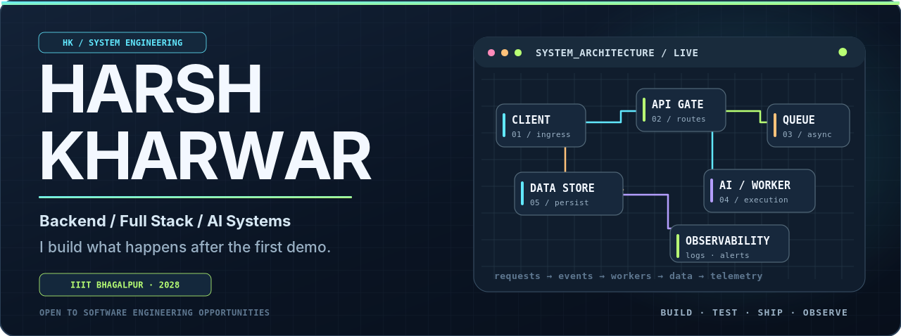
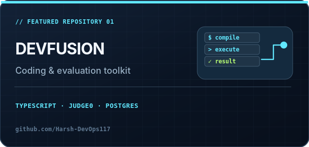
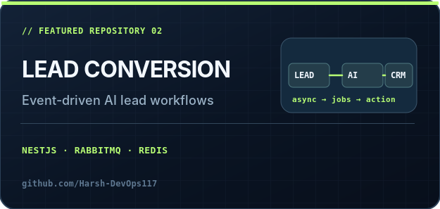
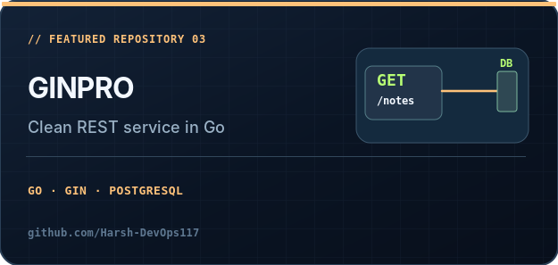
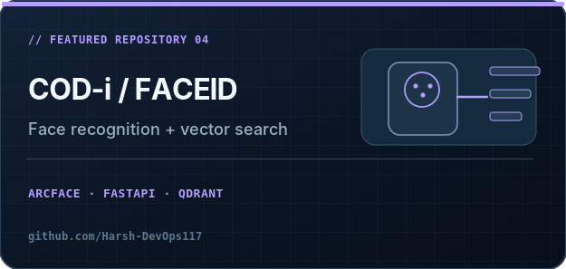
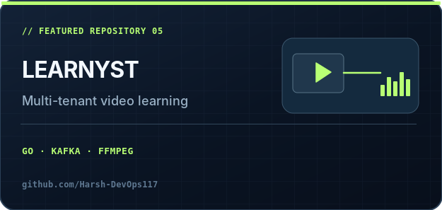
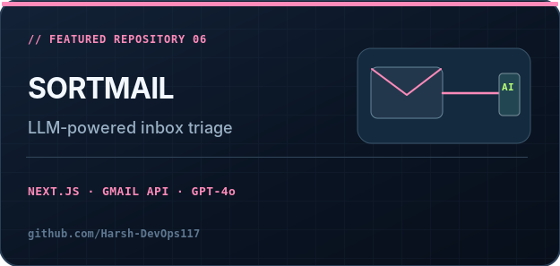
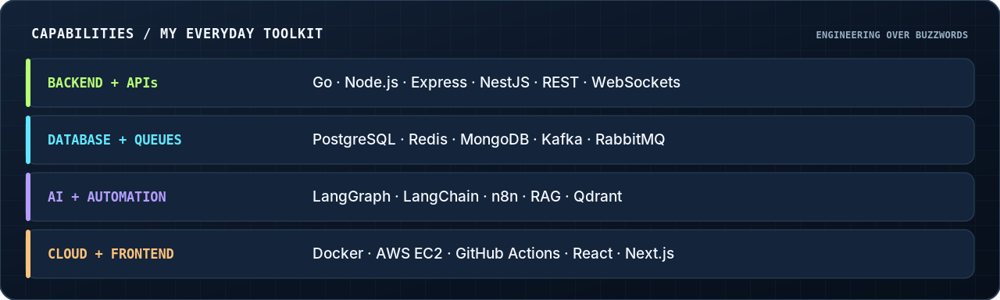
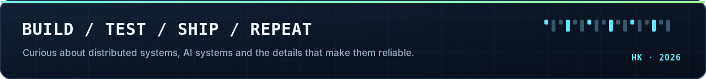

<!-- Harsh Kharwar · GitHub profile Keep README.md and assets/ in the ROOT of Harsh-DevOps117/Harsh-DevOps117. SVG originals included for editing; raster PNG references are intentional because GitHub image proxy / SVG sanitization may affect some SVG artwork. --> 
  
 <a href="https://www.linkedin.com/in/harsh-kharwar-093919282/">LinkedIn</a> &nbsp;·&nbsp; <a href="https://github.com/Harsh-DevOps117">GitHub</a> &nbsp;·&nbsp; <a href="https://x.com/HarshKharw26262">X / Twitter</a> &nbsp;·&nbsp; <a href="mailto:8707460911har@gmail.com">Email</a> 
 

01 / About me
I'm Harsh Kharwar, a software engineer and third-year B.Tech student in Mechatronics & Automation at IIIT Bhagalpur. I enjoy building backend services, full-stack products, AI workflows and the infrastructure that keeps them running.

My focus is not just shipping a prototype: I care about clean APIs, reliable async processing, data modeling, observability, and thoughtful product engineering.

Currently: AI & Full-Stack Developer Intern at ToriAte; Software Engineer Intern (Quality Engineering) at Soni Consultancy, working on the European Pay project.
Exploring: Go, distributed systems, agentic AI, message-driven backends and cloud deployment.
Campus: Training & Placement Coordinator at IIIT Bhagalpur.
02 / Experience
When	Role	What I'm working on
Sep 2026 — Present	AI & Full-Stack Developer Intern · ToriAte	AI agents, WhatsApp integrations, n8n workflows and backend automation.
Oct 2026 — Present	Software Engineer Intern (Quality Engineering) · Soni Consultancy	European Pay project: product-flow validation, API testing, bug investigation and reporting.
May — Jul 2026	Backend Engineering Intern · Enginow	Node.js services, background-job processing, Docker, deployment infrastructure.
May — Jul 2025	Frontend Developer Intern · Goitdev Technologies	React interfaces, reusable components and responsive frontend experiences.
03 / Pinned engineering work
Only the six repositories pinned on my GitHub profile are featured here. Each card links directly to the public repository.

<table> <tr> <td width="50%" valign="top">  <b>DevFusion / PrepGrid</b> — coding practice, evaluation and interview tooling with Judge0 integration. </td> <td width="50%" valign="top">  <b>Lead Conversion</b> — a NestJS backend foundation for lead-workflow and AI service orchestration. </td> </tr> <tr> <td width="50%" valign="top">  <b>GinPro</b> — authenticated Notes API using Go, Gin, PostgreSQL and a layered service architecture. </td> <td width="50%" valign="top">  <b>COD-i / FaceID Native</b> — face detection, recognition embeddings and similarity search. </td> </tr> <tr> <td width="50%" valign="top">  <b>Learnyst</b> — multi-tenant learning system featuring a video processing pipeline and asynchronous services. </td> <td width="50%" valign="top">  <b>SortMail</b> — intelligent inbox classification and prioritization built around Gmail and LLM integration. </td> </tr> </table>
04 / The toolkit

  

Beyond the stack: TypeScript, Python, Java, SQL, React Native, GSAP, Linux, automated testing, API testing, GitHub Actions, monitoring and debugging.

05 / Beyond the code
🏆 1st Place — DevFusion Hackathon
🏆 Best AI Implementation — QuasarX AI Hackathon
🎓 Training & Placement Coordinator, IIIT Bhagalpur
📍 B.Tech, Mechatronics & Automation Engineering · 2024–2028

  
Always happy to connect about backend engineering, useful AI, distributed systems, and building products.
 

Mr E
