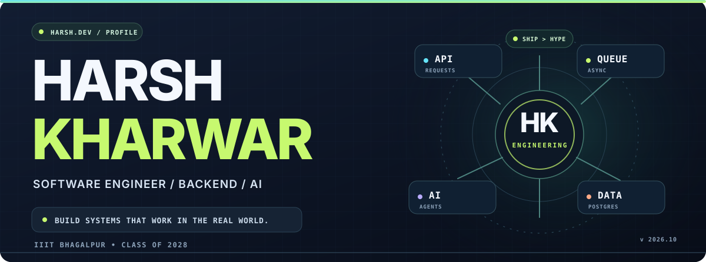
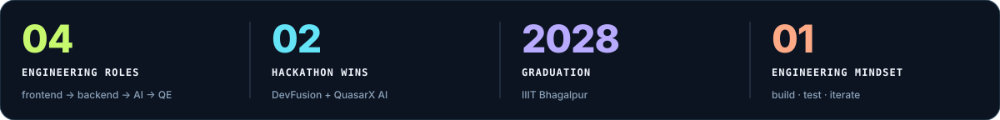
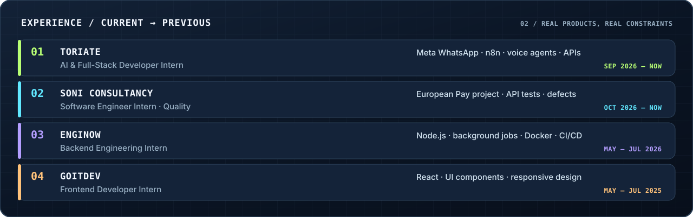
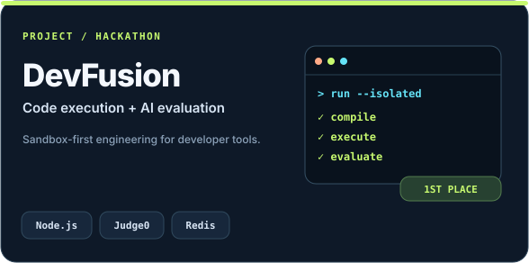
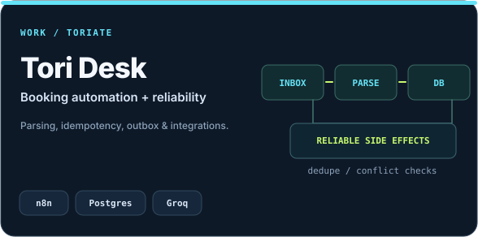
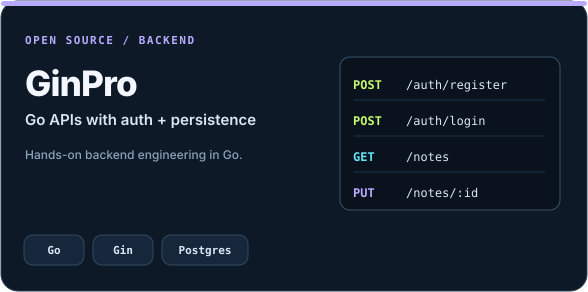
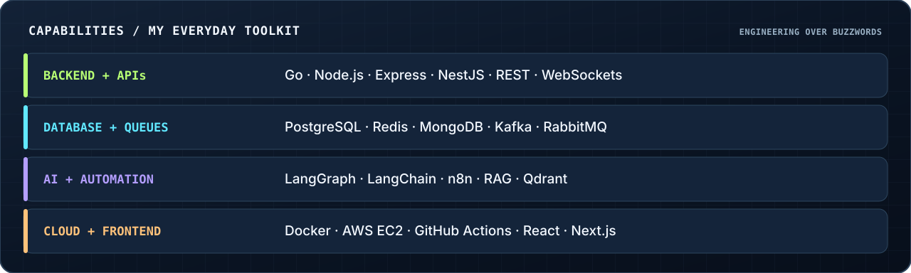

<!-- HARSH KHARWAR • GitHub Profile All artwork below is original SVG, stored locally in ./assets/. Commit README.md and the entire assets/ directory to your Harsh-DevOps117/Harsh-DevOps117 profile repository. --> 
             

01 / HELLO, WORLD.
I'm Harsh Kharwar, an engineering student at IIIT Bhagalpur and a developer who enjoys building the systems behind the interface — APIs, message queues, AI workflows, databases, and cloud deployments.

I like projects where the interesting problems happen after the first demo: reliability, concurrency, failure handling, integration design, and observability. I also build full-stack experiences and keep learning in public.

Building: WhatsApp AI workflows, backend services, and practical automation at ToriAte.
Engineering quality: API and product-flow testing at Soni Consultancy, working on the European Pay project.
Learning deeply: Go, distributed systems, system design, cloud infrastructure, and agentic AI.
Outside engineering: Training & Placement Coordinator at IIIT Bhagalpur; DSA in Java.
02 / ENGINEERING EXPERIENCE

My work spans AI + full-stack development, quality engineering, backend infrastructure, and frontend implementation. Most recently, I've worked on n8n/WhatsApp integrations, automated booking workflows, API testing, and structured defect reports.

03 / WORK I'M PROUD OF
<table> <tr> <td width="50%" valign="top">  <b>DevFusion / PrepGrid</b> — developer tooling, evaluation and sandboxing. <a href="https://github.com/Harsh-DevOps117/DevFusion">Explore code</a>. </td> <td width="50%" valign="top">  <b>Tori Desk</b> — email-to-booking automation, conflict checks, deduplication, and transactional outbox patterns. Work at ToriAte. </td> </tr> <tr> <td width="50%" valign="top">  <b>GinPro</b> — Go service with authentication and database-backed APIs. <a href="https://github.com/Harsh-DevOps117/GinPro">Explore code</a>. </td> <td width="50%" valign="top">  <b>COD-i / FaceID</b> — face recognition + vector search, built for QuasarX AI. <a href="https://github.com/Quasar-x-AI-2026/COD-i">Explore code</a>. </td> </tr> </table>
Other things I've worked on: a multi-tenant learning platform with Go and Kafka-powered video transcoding; a NestJS AI lead-workflow backend; WebRTC real-time calling; and deployment workflows using Docker, AWS, and GitHub Actions.

04 / THE TOOLBOX

Also in my workflow: TypeScript, Python, Java, SQL, React Native, Tailwind CSS, GSAP, Linux, Nginx, CI/CD, Prometheus, functional testing, regression testing, and bug reporting.

05 / SMALL WINS, BIG LESSONS
1st Place — DevFusion Hackathon. Built and demonstrated a developer-facing engineering project.
Best AI Implementation — QuasarX AI Hackathon. Worked on a face recognition and retrieval pipeline.
Training & Placement Coordinator — IIIT Bhagalpur. Helping connect students and recruiting teams.

      Open to conversations about backend engineering, full-stack development, AI systems, and building useful software. 

Mr E
