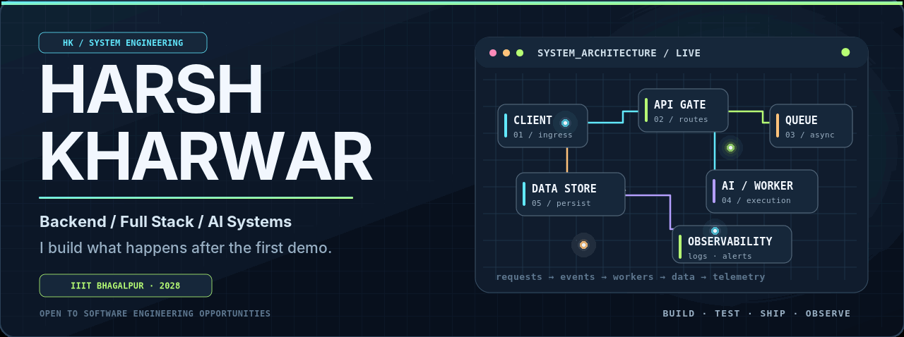
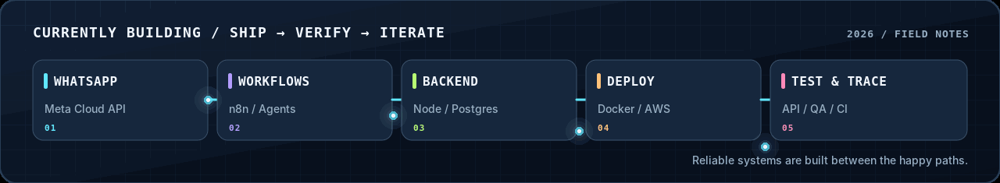
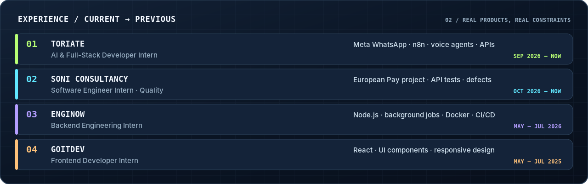
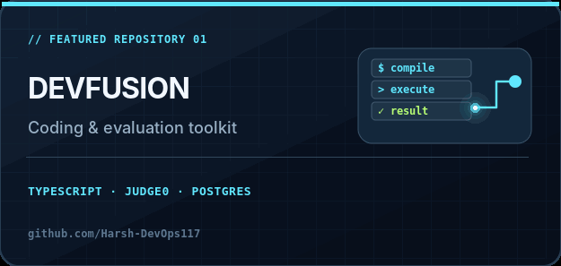
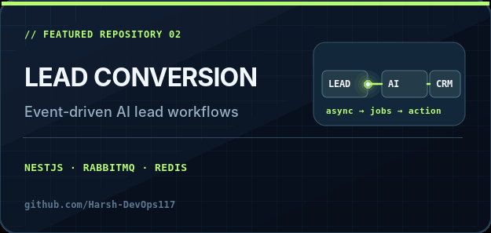
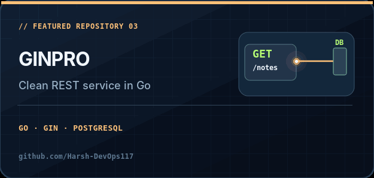
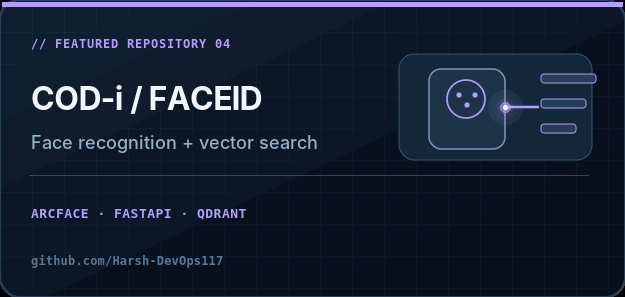
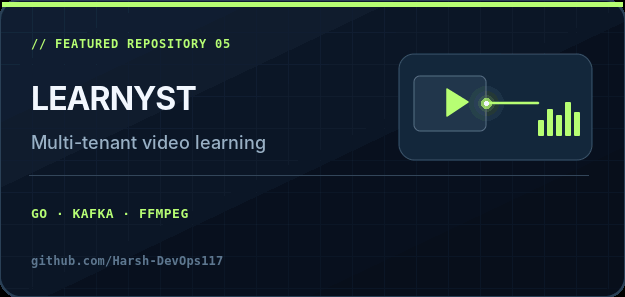
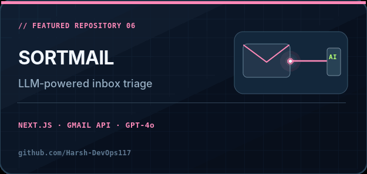
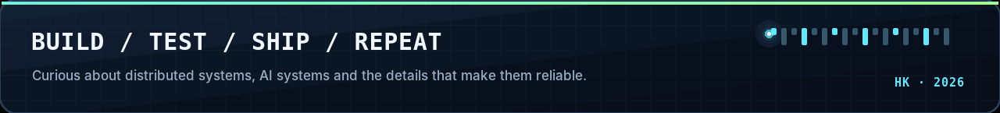

<!-- HARSH KHARWAR // GitHub Profile, motion edition Place this README.md and the complete assets/ folder in: https://github.com/Harsh-DevOps117/Harsh-DevOps117 GIF = GitHub-compatible animation. SVG = original animated vector artwork. All image paths are local. No third-party render services. --> 
  
 &nbsp; &nbsp; &nbsp; &nbsp;  
 Animated SVG source: <a href="./assets/hero.svg">hero.svg</a> · GIF fallback is used above for consistent GitHub playback. 

01 / ABOUT
Hey, I'm Harsh. I study Mechatronics & Automation at IIIT Bhagalpur (2024–2028), but I spend most of my time building software: APIs, AI-driven workflows, full-stack products, deployment pipelines and the infrastructure that holds them together.

I'm drawn to problems that start after an app works: reliability, queueing, edge cases, fault handling, performance and observability. I enjoy making things useful, and then figuring out how to make them hold up.

At ToriAte: building WhatsApp automation, n8n flows, voice-agent integrations and supporting full-stack services.
At Soni Consultancy: Software Engineer Intern (Quality Engineering), working on the European Pay project — testing product flows and APIs, reproducing bugs, and documenting issues.
In my own work: exploring Go, distributed systems, agentic AI, Docker/AWS deployments, and Java DSA.
On campus: Training & Placement Coordinator at IIIT Bhagalpur.

02 / EXPERIENCE

What that looks like in practice: Meta WhatsApp Cloud API and n8n orchestration, a developing WhatsApp voice-agent workflow, API and authentication-flow testing for European Pay, and Docker Compose / AWS EC2 / GitHub Actions deployment workflows. I also have prior experience with Node.js backend jobs and React interfaces.

03 / PINNED WORK — SIX REPOS, SIX PROBLEMS
These are the exact six projects pinned to my GitHub profile. The cards below are original SVG illustrations exported as animated GIFs for GitHub compatibility.

<table> <tr> <td width="50%" valign="top">   <b>DevFusion</b> · A developer-facing coding and evaluation platform, including sandboxed execution and interview tooling. <a href="https://github.com/Harsh-DevOps117/DevFusion">Source ↗</a> </td> <td width="50%" valign="top">   <b>Lead Conversion</b> · NestJS-based AI lead-workflow backend designed around asynchronous processing and modular services. <a href="https://github.com/Harsh-DevOps117/lead-conversion">Source ↗</a> </td> </tr> <tr> <td width="50%" valign="top">   <b>GinPro</b> · A Go/Gin backend with authentication, REST endpoints and database-backed operations. <a href="https://github.com/Harsh-DevOps117/GinPro">Source ↗</a> </td> <td width="50%" valign="top">   <b>COD-i / FaceID Native</b> · A face-detection and recognition pipeline using SCRFD, ArcFace, FastAPI and Qdrant vector search. <a href="https://github.com/Quasar-x-AI-2026/COD-i">Source ↗</a> </td> </tr> <tr> <td width="50%" valign="top">   <b>Learnyst</b> · A multi-tenant learning platform with asynchronous video-processing architecture. <a href="https://github.com/Harsh-DevOps117/Learnyst">Source ↗</a> </td> <td width="50%" valign="top">   <b>SortMail</b> · An AI-assisted inbox organization and prioritization project integrating Gmail with LLM features. <a href="https://github.com/Harsh-DevOps117/SortMail">Source ↗</a> </td> </tr> </table>
04 / ENGINEERING TOOLBOX

Also working with: TypeScript · Python · Java · SQL · React Native · GSAP · Linux · WebRTC · Socket.IO · JWT · functional and regression testing · API debugging · CI/CD · monitoring.

05 / MILESTONES
🏆 1st Place — DevFusion Hackathon
🏆 Best AI Implementation — QuasarX AI Hackathon
🎓 Training & Placement Coordinator — IIIT Bhagalpur
🌍 Remote software internships with international teams

  Always up for conversations about backend engineering, developer tools, AI systems and thoughtful software. 

Mr E
